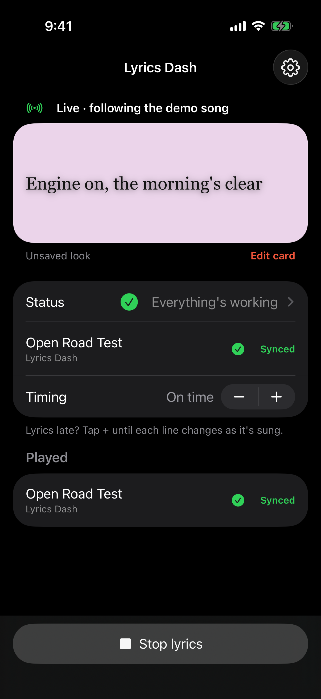
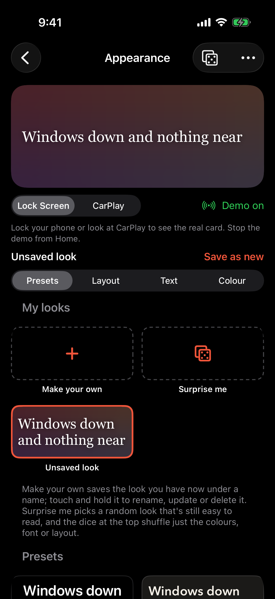
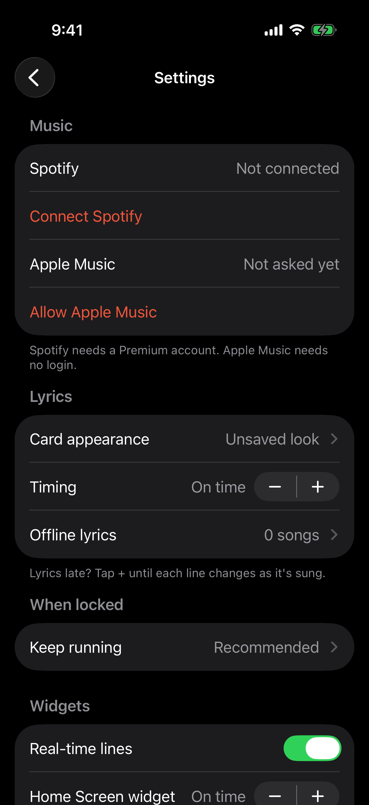
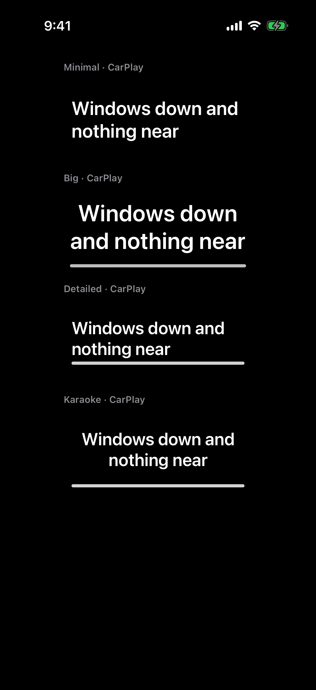
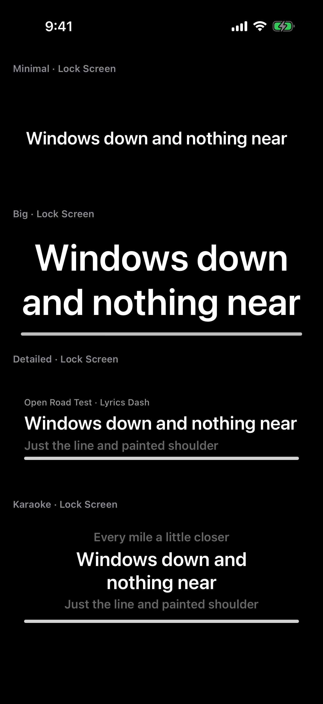
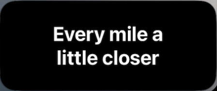
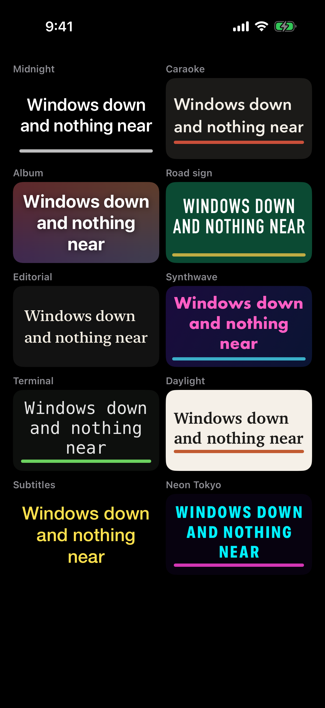
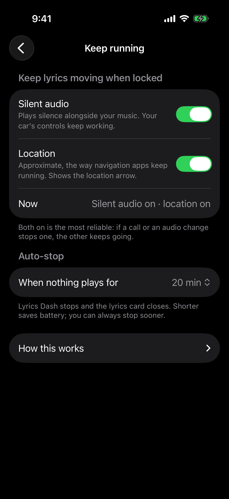
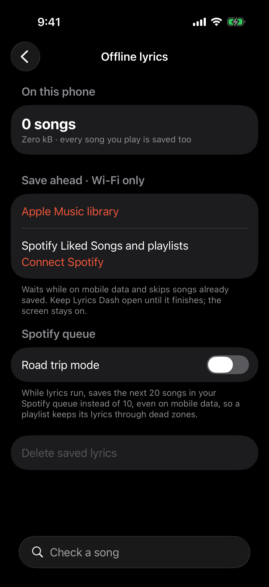
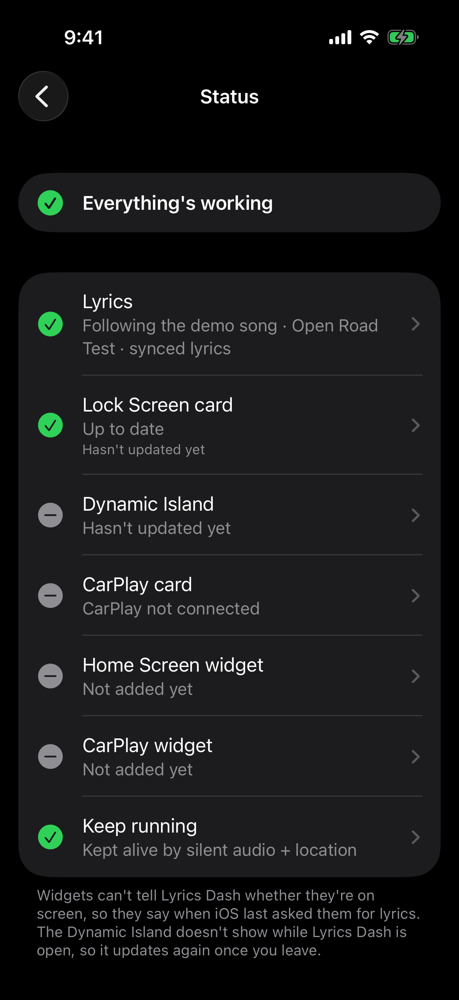

# Lyrics Dash

Synced, line-by-line lyrics on your **CarPlay** screen, for Spotify and Apple Music. It uses an iOS 26+ Live Activity, so it needs no CarPlay entitlement from Apple. The same card shows on the Lock Screen, the Dynamic Island and in widgets.

<p align="center">
  
  
  
</p>

## CarPlay and Lock Screen card

The card has four layouts (Minimal, Big, Detailed, Karaoke) and 20 presets, and you can make your own. This is how each layout renders on CarPlay and on the Lock Screen:

<p align="center">
  
  
</p>

The card on a real CarPlay screen (Apple's CarPlay Simulator connected to an iPhone, demo song):

<p align="center"></p>

> The layout images above are renders of the card from the app. Photos from a real car are welcome: see [Contributing](CONTRIBUTING.md).

## More screenshots

| Presets | Keep running | Offline lyrics | Status |
| --- | --- | --- | --- |
|  |  |  |  |

## Features
- Spotify (Premium) and Apple Music. Lyrics come from [LRCLIB](https://lrclib.net), which is free and needs no key.
- Live Activity on CarPlay, the Lock Screen and the Dynamic Island, plus Home Screen, StandBy, Lock Screen and CarPlay widgets.
- Customisable card: layouts, fonts, colours, presets, "Surprise me".
- Per-song timing adjustment, and a **Status** screen that says what's working and what isn't.
- Keeps running in the background (silent audio and low-accuracy location).
- Offline: lyrics for songs you've played, your queue, or your whole library are saved on the phone.

## Requirements
- iPhone 11 or newer on **iOS 26+** (CarPlay only shows Live Activities from iOS 26)
- A Mac with **Xcode 27** and [XcodeGen](https://github.com/yonaskolb/XcodeGen) (`brew install xcodegen`)
- An Apple ID (a free one works; the install expires after 7 days and you re-run it)
- For Spotify: a Premium account and a free [Spotify developer app](https://developer.spotify.com/dashboard)

## Quick start
```sh
git clone https://github.com/ispa21/car-lyrics.git && cd car-lyrics
cp Local.xcconfig.example Local.xcconfig   # add your Apple team ID (and Spotify Client ID)
xcodegen
open LyricsDash.xcodeproj                  # pick your iPhone, press ⌘R
```
The full walkthrough (phone setup, Spotify, CarPlay, troubleshooting) is in **[docs/SETUP.md](docs/SETUP.md)**. No car? Use **Try the demo song** in the app, or the CarPlay Simulator.

## Docs
- [docs/SETUP.md](docs/SETUP.md): step-by-step install and use
- [docs/DEVELOPMENT.md](docs/DEVELOPMENT.md): how it works (background running, widgets, offline cache)
- [docs/FEASIBILITY.md](docs/FEASIBILITY.md): why a Live Activity, and what was tried

Run the core tests with `cd LyricsCore && swift test`.

## Limitations
- It's a sideloaded personal build, not an App Store app. Keeping the app alive in the background with silent audio and location would not pass App Review.
- Not supported: YouTube Music and other apps (iOS doesn't let apps see what another app plays).
- Lyrics are fetched from LRCLIB at runtime and aren't bundled; not every song has synced lyrics there.

Not affiliated with Spotify, Apple or LRCLIB.

## License
[MIT](LICENSE)
